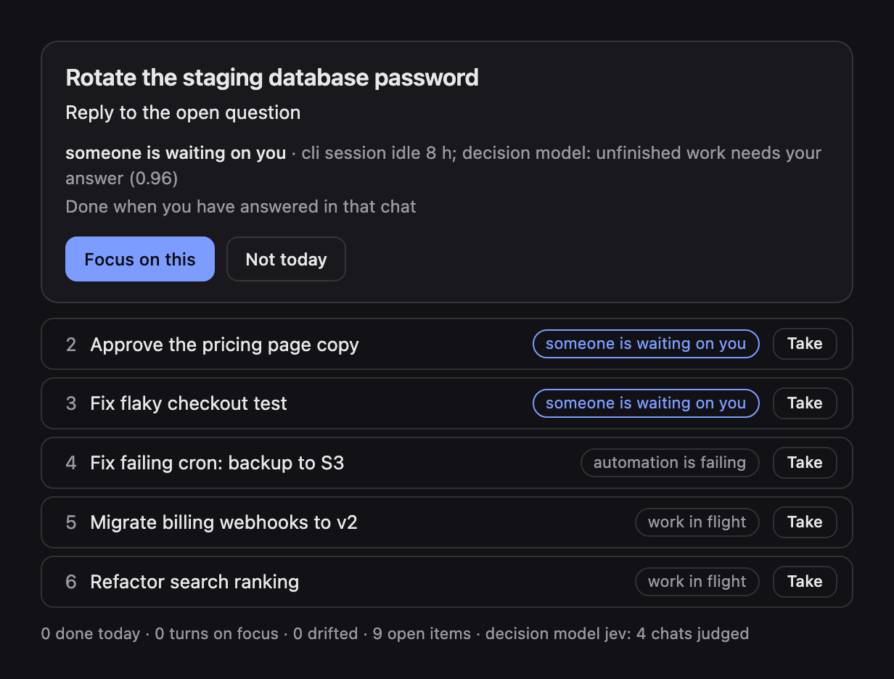

# Focus

One thing to work on now, picked from what Hermes already knows, and guarded while you do it.

Hermes accumulates open loops: Kanban cards blocked on you, chats where the agent asked a question and you never answered, cron jobs failing quietly, things you said you would do by Friday. Focus reads all of it, picks one item with rules you can read, leases it for 90 minutes, and keeps the agent pointed at it.

```
PROPOSED  Approve the pricing page copy
  next   Answer the blocker so the task can move
  why    someone is waiting on you: Kanban t_a1 is blocked (needs_input); priority 150; unblocks 2 other task(s)
  open   hermes kanban show t_a1

then:
  2. Fix flaky checkout test  [someone is waiting on you]
  3. Fix failing cron: backup to S3  [automation is failing]
  4. Migrate billing webhooks to v2  [work in flight]
```



## What it does that a prompt cannot

- **Reads real state.** Open Kanban tasks (and which ones unblock others), interactive chats whose last agent message asks you something, cron jobs with a failure streak, and commitments you record. Machine sessions (cron, subagents, workers) are ignored.
- **Decides deterministically.** Hard gates first: due within 24 h, then someone waiting on you, then failing automation, then work in flight, then backlog. A weighted score only breaks ties inside a gate. Same state, same answer. No model call.
- **Holds a lease.** Once you accept, routine re-ranking cannot replace the focus. Only something strictly more urgent (a deadline under 24 h, or someone waiting on you when your focus is lower) is offered as an interruption, and you decide.
- **Guards against drift.** A `pre_llm_call` hook notices when a turn has nothing to do with the leased focus and adds one line of context for the agent: help, keep it short, offer to return. At most once per 20 minutes per chat. Never blocks. Off for cron, subagents and other unattended runs.
- **Closes itself.** When the focused Kanban task completes, the `kanban_task_completed` hook ends the lease with the worker's summary as proof.
- **Asks for proof.** Every item says what "done" looks like. `done` needs evidence (a test result, a link, a sent message). `/now review` shows what you finished, how long it took, and how many turns stayed on focus.
- **Explains the ranking.** `/now why` lists every open item with its level, its score, the factors behind the score and the evidence. `/now pin 4` is your own word that an item matters: it lifts the item above inferred work, and a deadline inside 24 hours still comes first.
- **Shows it.** The same card renders in the Desktop pane, inline in any Desktop chat, and as plain text on every other surface.

## Use

| Surface | How |
|---|---|
| Chat | `/now`, `/now accept [n] [min]`, `/now done <proof>`, `/now defer [n] [hours]`, `/now add <what> [by <when>]`, `/now why`, `/now pin <n>`, `/now unpin <n>`, `/now review` |
| Agent | tools `focus_now`, `focus_accept`, `focus_done`, `focus_defer`, `focus_add`, `focus_rank`, `focus_pin` (the agent only accepts or pins after you agree) |
| Terminal | `hermes focus`, `hermes focus accept 2`, `hermes focus why`, `hermes focus --json`, `hermes focus --html` |
| Desktop | Focus pane with pin buttons, status-bar chip with lease minutes, Focus page, palette command, settings form in the Plugins tab |
| Desktop chat | `::focus{}` alone on a line renders the live card inline (needs the desktop half). Without it, `focus_now` writes a self-contained HTML card that `::preview{file="..."}` renders, with buttons that talk to the agent |

Deadlines: `+3h`, `+2d`, `today`, `tomorrow`, `2026-11-11`, `2026-11-11 17:00`.

## Optional decision model

Off by default. The plain rules decide that a chat is waiting on you from the shape of the agent's last message: it ends with a question, or says "want me to". An agent that finished the job and then offered an extra looks the same as an agent that is blocked on your approval. A decision model can tell them apart.

Turn it on with `decision_model: jev` or `decision_model: llm` (settings below, or the Plugins tab in Desktop).

- The model answers three yes/no questions about one chat and returns probabilities: does unfinished work need your answer, is only an optional offer open, is requested work unfinished. It never ranks, never sees the other items and never picks the focus.
- Policy stays in code (`engine.apply_judgment`). At 0.70 or above an answer may move a chat between levels. At 0.30 or below it counts as no. Between the two the answer is undecided and the plain rules stand. `/now why` prints the probability beside every item it touched.
- Answers are cached by a digest of the exact text judged. The same state gives the same answer, and a repeated `/now` makes no call.
- Every failure leaves the plain rules in charge: no key, a timeout, bad JSON, a probability out of range. The judge has a 6 second budget for `jev` and 30 seconds for `llm`, and it never runs inside a hook.

Measured on the demo seed (`python3 demo/seed.py /tmp/home --extras`) against the live `jev` backend: 4 chats judged in 0.34 s, 3 ms from cache on the next call. The chat blocked on an approval that the rules missed moved to the top (0.97). The chat with only an optional offer moved from the top to the backlog (0.87).

| Backend | What it is | Needs |
|---|---|---|
| `jev` | TypeSafe System One, a calibrated decision model. About 0.4 s per refresh | `TYPESAFE_API_KEY`, read through Hermes's secret scope |
| `llm` | Your own Hermes model through `ctx.llm`. Slower, and its probabilities are a model's self-report | Nothing extra |

## Install

```bash
hermes plugins install acadine-intelligence/hermes-focus
hermes plugins enable focus
```

Desktop: Capabilities → Plugins → enable the Focus desktop half.

Settings (`plugins.entries.focus.settings` in `config.yaml`, or the Plugins tab in Desktop): `lease_minutes` (90), `session_window_days` (3), `drift_guard` (true), `decision_model` (`off`), `decision_model_max_chats` (8).

## Disclosure

- **Reads outside its own data, read-only:** the active profile's `state.db` (session titles, the last user/assistant message of recent interactive sessions), `kanban.db` (open tasks and links), and `cron/jobs.json` (job names, status, last error). SQLite files open in read-only mode.
- **Writes only** `<HERMES_HOME>/plugin-data/focus/` (`focus.json`, a lock file, `card.html`, and `judge-cache.json` when the decision model is on).
- **Injects context:** a system prompt section naming the leased focus, and the one-line drift note described above.
- **Default: no network calls, no model calls, no credentials.**
- **Only when you set `decision_model: jev`:** HTTPS calls to `api.typesafe.ai`. Each call carries one chat's title, the last user message (up to 700 characters) and the last agent message (up to 1,600 characters), for at most 8 chats per refresh. The key `TYPESAFE_API_KEY` is read through `agent.secret_scope.get_secret` and is never stored by the plugin.
- **Only when you set `decision_model: llm`:** the same text goes to your own Hermes model through `ctx.llm` (at most 4 chats per refresh).
- **No shell commands, no background processes, no telemetry.**

## Develop

```bash
uv venv -p 3.11 .venv && uv pip install -p .venv/bin/python pytest
.venv/bin/python -m pytest
hermes plugins validate . && hermes plugins doctor --ci .
python3 demo/seed.py /tmp/focus-demo            # fictional Hermes home for demos
python3 demo/seed.py /tmp/focus-demo --extras   # plus two chats that show what the decision model changes
```

`hermes_focus/` is the engine (stdlib only): `sources.py` reads Hermes state, `engine.py` holds the levels, the score and the decision-model policy, `judge.py` is the optional decision model, `render.py` and `render_html.py` draw the card. `__init__.py` wires it into Hermes. `dashboard/plugin_api.py` serves the Desktop pane. `desktop/plugin.js` is the pane and the inline card.

MIT licence.
